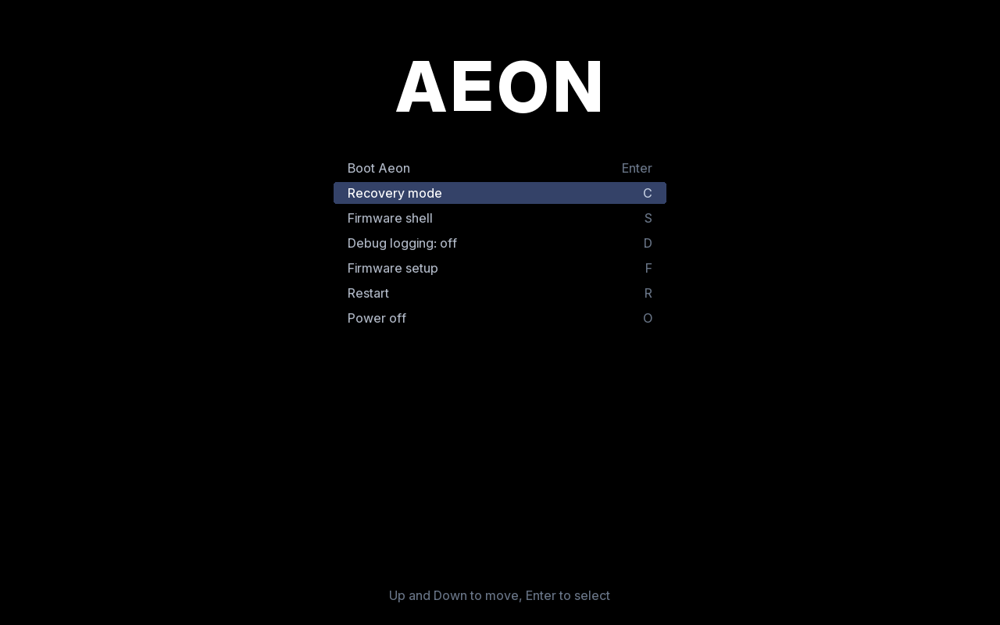
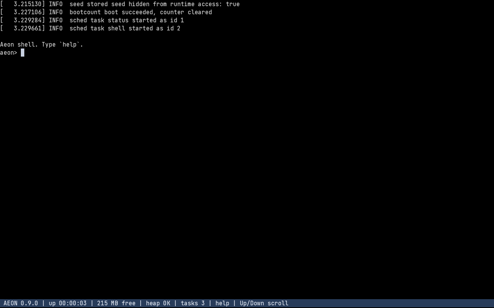

# Aeon

A small UEFI x86_64 boot stage and small kernel (about 572 KB, under the 640 KiB size limit the tests enforce; boots in 64 MB of RAM) in Rust (`no_std`, no dependencies). It boots from a USB
stick on a UEFI PC, shows a logo with a progress bar, measures its command line into the TPM, seeds its
own randomness, leaves firmware control, sets up its own CPU and memory protections, and drops into a
preemptive multitasking kernel with a shell.

**New in 0.11.0** (see `docs/RELEASE-0.11.0.md`): real processes. Every program has its own page tables, `fork`/`execve`/`wait4`/`pipe` exist, `/bin` holds small Rust programs (`hello echo cat wc ls forktest`), the shell has pipes, `>`, `>>`, `&` and Ctrl+C, and `date` reads the clock chip. **This version was built and unit-tested on the host only; it has not been booted in QEMU or on the laptop.**

**New since 0.10.0:** internet through a phone's USB tethering (RNDIS and CDC-ECM, `dhcp` after plugging in) and the laptop's own I2C touchpad (`touchpad`; both untested on real hardware, see `cmd.md`).

**New in 0.10.0** (see `docs/RELEASE-0.10.0.md`): real TCP/DNS/HTTP (`dhcp`, `curl <url> [-o file]`, `sha256sum`), a signed package manager (`apt help`), USB mouse with an on-screen pointer (`mouse`), a Realtek RTL8168 wired driver (untested on hardware) and a tested WPA2 Wi-Fi stack with **no Wi-Fi chip driver yet** (`wifi status`). How Aeon compares with other systems and what is still missing: `docs/OS-LANDSCAPE.md`.

## Boot from a USB stick

1. Format a USB stick as **FAT32**.
2. Copy everything inside the `usb` folder to the root of the stick (you get `EFI/`, `SHA256.txt` and
   `aeon-secureboot.cer`).
3. Boot the PC from the stick through its boot menu (F12, F10, Esc or F9) in **UEFI** mode.

The image is **signed** with the Aeon release key. Two ways to run it:

- **Secure Boot off** in the firmware setup: nothing else to do.
- **Secure Boot on**: add `aeon-secureboot.cer` to the firmware's `db` (Secure Boot key management,
  "Append"/"Enroll" from file; the menu name differs per vendor), or enroll the image hash from
  `SHA256.txt`. Aeon is not signed by Microsoft, so firmware with only the factory keys refuses it.

Check the copy with `SHA256.txt` (`sha256sum -c SHA256.txt` or `Get-FileHash`).

While booting you see the logo fade in and a thin bar fill as the real boot stages complete. The boot menu
(Dawn) opens first with "Boot Aeon" highlighted and counts down 15 seconds (`timeout=N` in `aeon.cfg` changes it, up to 30; `nomenu` skips Dawn). The seven entries are Boot Aeon, Recovery mode, Firmware shell, Debug logging, Firmware setup, Restart and Power off; a short line under the list says what the highlighted one does. Only the arrow keys and Enter are used (no letter shortcuts). Each arrow press restarts the countdown, which keeps running on every entry. When it ends the highlighted entry starts if it is Boot Aeon or Recovery mode; on any other entry (firmware shell, debug, firmware setup, restart, power off) Aeon boots normally instead, so nothing restarts, powers off or changes settings without Enter. Any other key stops the countdown. Booting from the menu goes back to the splash; leaving it for recovery or the firmware shell shows the full boot log.

Menu keys: `Enter` boot, `C` recovery mode, `S` firmware shell (a shell that runs before the kernel through the
firmware's own input, so USB keyboards work; `boot` continues), `D` debug logging, `F` reboot into firmware
setup, `R` reboot, `O` power off.
Boot options (image command line / UEFI load options, plus the text file `EFI/BOOT/aeon.cfg` on the stick, one
setting per line, `#` starts a comment): `quiet`, `debug`, `verbose` (log instead of
splash), `nomenu`, `timeout=N`, `mode=WxH` (pick a screen mode, e.g. `mode=1920x1080`), `recovery` (force recovery
mode), `nocount` (turn boot counting off), `nolapic` (keep the legacy PIT timer instead of the local APIC timer). `debug` implies `verbose`. The options from the command line and `aeon.cfg` are what gets
measured into the TPM.

Shell keys use a PS/2 keyboard (laptop keyboards and most USB keyboards in firmware "legacy" mode).

## What happens at boot

| Stage | What happens |
|---|---|
| firmware-entry | stop the 5-minute firmware watchdog, calibrate the TSC against firmware `Stall`, start log sinks, publish `LoaderInfo` (systemd Boot Loader Interface) |
| early-init | bounds-checked CPUID, control-register state, GOP framebuffer in the firmware's own (native) mode, logo fade-in |
| platform-discovery | firmware vendor/revision, image base/size, ACPI RSDP checksums, SMBIOS, Secure Boot / Setup Mode, TPM 2.0 presence |
| security-init | boot random seed from the firmware RNG and RDRAND, randomised stack canary, command line measured into TPM PCR 12 and read back to verify |
| exit-boot-services | a boot-phase marker is measured into PCR 11 just before leaving the firmware |
| boot menu | Dawn opens first and counts down; keys come through the firmware (works with USB keyboards) |
| (same stage) | size the memory-map buffer from the firmware, fetch map, exit, retry on a stale key; no logging in between |
| kernel-env | copy the memory map, enable NX, GDT/TSS (double-fault stack), IDT, identity-mapped page tables with W^X, unmapped null page and stack guard pages, CR0.WP/SMEP/SMAP/UMIP when supported, own stack |
| kernel-memory, kernel-tasks | frame allocator, 32 MB heap, tick source (local APIC timer, or the PIT if there is no xAPIC or with `nolapic`), scheduler with `status` and `shell` tasks; the boot thread idles on `hlt` |

Shell commands: type `help` for the grouped list (`help all` for every command with a description). Files: `ls tree cd pwd mkdir rmdir cat write append edit rm df`.
The RAM filesystem has folders (up to 64 files and folders, 1 MiB, names up to 32 characters, paths up to 128; `write` takes the two characters backslash and n for a new line, `edit <file>` takes many lines). `dls dcat disks dread pci` read a FAT16/FAT32 disk on a virtio-blk device (read-only). `run <hello|fault|gp|spin|badcall|denied>` starts a built-in program in ring 3 (each program has a syscall allow-list: `denied` tries a call it may not make and must be refused). `spawn` starts two busy workers that never yield; `counters` shows both advancing, i.e. the
timer interrupt preempting them. `log` prints the boot log, which the splash held back. Shutdown uses ACPI
S5, then firmware `ResetSystem`.

Log lines: `[seconds.microseconds] LEVEL target key=value ...`, sent to the screen (when not in splash),
COM1 (if present), QEMU debugcon port `0xE9` and a 64 KiB ring.

A fatal error (panic or CPU exception) shows a stop screen with the cause and nothing else: no addresses
or register values. Those go to serial and debugcon only.

## Security

- **Secure Boot ready**: the release image is signed; its certificate ships in `usb/` for enrollment.
- **Measured boot**: the boot command line is hashed into TPM PCR 12 (event type `EV_IPL`) through
  `EFI_TCG2_PROTOCOL`, then the PCR is read back and compared with the value computed from the previous
  one. The firmware's own event log stays valid. The firmware measures this image into PCR 4 itself.
- **Revocation metadata (SBAT)**: the image carries an `.sbat` section (generation 1, component `aeon`), for a shim-based chain that reads SBAT. Firmware that loads Aeon directly ignores it; revoking an old build there goes through the `dbx` list.
- **Boot counting and recovery mode**: a counter in the firmware's variable store is raised at the start of
  every boot and cleared once the kernel is up and its boot-time self-tests survived. After 3 failed boots
  in a row the next boot enters recovery mode: log on screen, the menu waits 10 s for a key, no timer
  interrupt and no scheduler, a single-task shell, and a different boot-phase marker in PCR 11 so secrets
  sealed to a normal boot stay shut. This helps with failures the recovery path avoids (splash, screen
  mode, timer, scheduler, TPM calls); it is not a rollback, because there is only one image. `nocount`
  turns the counter off if a firmware's variable writes ever misbehave.
- **Event-log replay**: before leaving the firmware, Aeon reads the TPM event log, replays it and compares
  the result with the TPM's PCRs 0 to 7, 11 and 12. `tpm` and `security` show the outcome. A mismatch
  means the log, the TPM or a measurement is wrong.
- **Boot-phase measurement**: a marker is extended into PCR 11 just before Aeon leaves the firmware, so a secret sealed to PCR 11 only opens for a boot that got that far (to just before leaving the firmware; a crash later in the kernel still holds the normal marker).
- **Last-panic record**: a panic or CPU exception stores a short text (no addresses) in a firmware variable;
  the next boot logs it once and deletes it. `lastpanic` shows it, `security` says whether the previous boot panicked, never finished booting (a hang or reset, seen from the boot counter) or left no failure record.
  This is a small version of Linux pstore.
- **Seed history**: each boot stores a seed derived from its own (never the seed itself) and mixes the
  previous one into the next, so a machine with no RNG hardware still varies between boots. It is readable
  by the boot stage only (the variable has no runtime access, and the kernel checks that the OS side cannot
  see it). It only adds to the hardware sources: with none of them, `security` does not call the canary random.
- **Boot Loader Interface**: besides `LoaderInfo`, Aeon publishes `LoaderFirmwareType`, `LoaderFirmwareInfo`,
  `LoaderImageIdentifier` and `LoaderTimeExecUSec` and reads them back, so `bootctl status` on Linux can
  show what booted the machine. It claims no `LoaderFeatures`, because Aeon does not implement those.
- **Secure Boot detail**: `security` shows whether a platform key is enrolled and how large the `dbx`
  revocation list is, not only the on/off flag.
- **Boot random seed**: SHA-256 over the firmware RNG, four RDRAND words and timing. It seeds the kernel
  stack-overflow canary. The seed is never logged. If neither hardware source exists, the log warns.
- W^X page tables from the PE section headers, NX everywhere else, unmapped null page, `CR0.WP`, and
  SMEP/SMAP/UMIP when the CPU has them. Registers are read back and logged, not assumed from CPUID.
- Guard pages under the kernel stack and every task stack (overflow faults instead of corrupting memory),
  plus a canary check; a separate double-fault stack.
- Memory freed by the firmware is zeroed before reuse, and freed heap blocks are scrubbed.
- Firmware input is bounded and validated: ACPI tables checked for signature, length and checksum and
  required to lie inside firmware-described memory; memory-map sizes saturate instead of overflowing;
  command-line options parsed from a fixed grammar. The parsers get random and mutated input in the unit tests (not a coverage-guided fuzzer).
- Reports Secure Boot / Setup Mode and TPM presence honestly; makes no attestation claims.
- CET (shadow stack, branch tracking) and RDSEED are detected and shown by `security`; CET is **not enabled**, because neither QEMU nor software emulation can run it, so it cannot be tested here.
- **Ring 3**: one built-in user program at a time runs in a 64 KiB window (code page read+execute, rest read+write, never both). `syscall` (write, exit, yield, uptime, getpid) validates pointers against the window and reads them with SMAP lifted only for the copy. A user fault or bad call ends only that task.
- Not yet: kernel signature check beyond the firmware's, loading user programs from files.

## Compared with other boot systems

| Idea | Linux (shim, GRUB / systemd-boot, UKI) | Windows (bootmgfw, winload) | macOS (Apple silicon) | Aeon |
|---|---|---|---|---|
| Signed chain | shim (Microsoft-signed), then signed loader and kernel | `bootmgfw.efi`, `winload.efi`, boot drivers, ELAM | Boot ROM, LLB, iBoot, kernel; signed system volume | one signed image; certificate to enroll |
| Measured boot | PCRs 4, 7, 9, 11, 12 | PCR 7 and the TCG log, used by BitLocker | Secure Enclave policy, no TPM | command line into PCR 12, verified by read-back |
| Boot menu | GRUB, systemd-boot | Windows Boot Manager | Startup Options | menu first, 1 s countdown, firmware input |
| Boot options | kernel command line | BCD store | boot-args | `quiet debug verbose nomenu timeout=N` |
| Firmware setup from the menu | `systemctl reboot --firmware-setup` | "UEFI Firmware Settings" | n/a | `F` in the menu (OsIndications) |
| Tell the OS who booted it | Boot Loader Interface variables | BCD / `bootmgr` state | iBoot handoff | publishes `LoaderInfo` |
| Entropy handoff | random seed file and `LoaderRandomSeed` | boot entropy block | boot-time entropy | firmware RNG + RDRAND seed in `BootInfo` |
| Free boot memory after exit | `init_on_free` | memory manager takes over | n/a | zeroes reclaimed memory |
| Memory protection from the start | kernel W^X, guard pages | HVCI / VBS, kernel DEP | KTRR/PPL | W^X, guard pages, SMEP/SMAP |
| Boot screen | Plymouth, firmware logo (BGRT) | logo and spinner | logo and bar | logo, fade, bar tied to real stages |
| Automatic fallback | boot counting in systemd-boot | recovery environment | recoveryOS | none (single image, nothing to fall back to) |

## Build and test

```
rustup target add x86_64-unknown-uefi
cargo build --release              # target/x86_64-unknown-uefi/release/aeon.efi
cargo clippy --release -- -D warnings
cargo test --lib --target x86_64-pc-windows-gnu     # or x86_64-unknown-linux-gnu: host unit tests
bash tools/release.sh              # build, sign, refresh usb/ (signing needs WSL with sbsigntool)
bash tests/run.sh                  # lint, unit tests, then the QEMU boot tests below
```

The boot tests (`tests/boot_test.py`) need QEMU, OVMF, swtpm, sbsigntool and virt-firmware (on Ubuntu:
`qemu-system-x86 ovmf swtpm sbsigntool openssl python3-virt-firmware`). They boot the real image and check:

- all boot stages, the seed, the splash (pixel checks on screenshots), the menu, the shell and preemption;
- measured boot with a software TPM: PCR 12 equals `SHA256(before || SHA256(cmdline))` computed
  independently, and the no-TPM path;
- Secure Boot: a signed image boots, an unsigned image and an image from an unknown key are refused;
- `aeon.cfg`: options are read, shown and measured into PCR 12 (checked against an independent calculation);
- screen modes 640x480, 1024x768 and 1920x1080 (the logo and bar are centred and inside the screen);
- the firmware shell (menu key `S`: `version`, `tpm`, `security` work before the kernel, kernel-only
  commands are refused, `boot` continues) and recovery from the menu (`C`);
- the last-panic record after a panic and after a CPU exception (shown once, no addresses);
- seed history across two boots, the five Boot Loader Interface variables, and the platform-key report
  with Secure Boot on;
- boot counting: three panicking boots on one NVRAM image start recovery, a good boot clears the counter,
  and `nocount` turns it off;
- event-log replay: the parser is also unit-tested against a real OVMF + swtpm log (captured with
  `tests/capture_eventlog.py`) whose replay must reproduce the PCRs the TPM reported;
- the image file itself: `.sbat` present in the build and in the signed release, size budget;
- the new shell commands (`version`, `security`, `tpm`) against a software TPM;
- the shipped `usb/` folder: checksums, contents, and that it boots after enrolling its certificate;
- every `fault-*` build ends in the expected exception or panic and shows the stop screen.

Screenshots land in `target/test-shots/`. Set `AEON_GIT_HASH` at build time to show a revision in the
banner. The fault features (`fault-ud fault-pf fault-stack fault-wx fault-nx fault-panic`) each trigger one
fault after boot; build them with `cargo build`, never into `usb/`.

## Try it on Windows before using a USB stick

`powershell -ExecutionPolicy Bypass -File tools\run-qemu.ps1 -Build -Disk` builds Aeon and opens it in a QEMU window (needs QEMU in `C:\Program Files\qemu`). `-Disk` attaches a demo FAT disk (`disks`, `dls`, `dcat hello.txt`), `-Release` runs the signed files from `usb/`, `-Cfg "mode=1920x1080"` writes an `aeon.cfg`, `-Mem 64` limits the RAM. The serial log is `target\qemu-serial.log`.

## Look and feel

Text is drawn with smooth fonts rasterised ahead of time by `tools/genfont.py` (Inter for the wordmark and menu, JetBrains Mono for the shell, both under the SIL Open Font License; texts in `docs/licenses/`). `gfont.rs` looks glyphs up and blends them, `anim.rs` has the easing used by the splash fade and the progress bar. Nothing is needed to build Aeon beyond the committed `fontdata.rs`; Pillow is only needed to regenerate it. The design notes (comparison with other systems, scheduler, security and AI plans) are in `docs/design/aeon-system-design.md`.

### Screenshots

Taken by the boot tests (`target/test-shots/`) from the 0.9.2 build in QEMU.

| Splash | Dawn boot menu | Shell |
|---|---|---|
|  |  |  |

## Source layout

| File | Role |
|---|---|
| `main.rs` | boot flow, boot menu, seed and measured boot, kernel start, panic handler |
| `uefi.rs` | hand-written UEFI bindings, every used table offset asserted at compile time |
| `arch.rs` | x86-specific code: port I/O, CPUID, RDRAND, control registers, GDT/TSS/IDT, exception and switch stubs, PIC/PIT, UART |
| `gfont.rs`, `fontdata.rs`, `anim.rs` | smooth fonts (generated data), glyph blending, easing |
| `spin.rs`, `waitq.rs` | interrupt-safe spinlock, wait-queue list (`sched::WaitQueue` blocks and wakes tasks) |
| `apic.rs`, `apicmath.rs` | local APIC timer (TSC-calibrated, periodic) and its host-tested arithmetic |
| `paging.rs` | identity-mapped page tables, W^X, guard pages |
| `mm.rs`, `frames.rs`, `heapalloc.rs` | frame bitmap allocator, free-list heap, `GlobalAlloc` |
| `sched.rs` | preemptive round-robin tasks (registers + FXSAVE on each stack) |
| `usermode.rs`, `usercopy.rs`, `syscall.rs` | ring-3 entry and demo programs, user-pointer checks, syscall numbers |
| `ramfs.rs` | RAM filesystem with folders, path resolution (`.`, `..`), backslash-n escapes (pure, unit-tested) |
| `pci.rs`, `virtio.rs`, `vblk.rs`, `block.rs`, `fat.rs` | PCI scan, virtio 1.0 helpers, polling virtio-blk driver, block-device trait, read-only FAT16/FAT32 |
| `lineedit.rs`, `cmdhelp.rs` | shell line editor, command table (help, Tab completion, did-you-mean) |
| `schedpolicy.rs`, `banker.rs` | pure FCFS/SJF/SRTF/priority/round-robin simulator and Banker's algorithm with deadlock detection, tested with the course's worked examples (not used by the kernel yet) |
| `shell.rs`, `keymap.rs`, `power.rs` | shell and status bar, scancode decoder, reboot and ACPI power-off |
| `fb.rs`, `font.rs`, `log.rs` | framebuffer console, splash and stop screen, public-domain 8x8 font, logger and sinks |
| `sha256.rs`, `entropy.rs`, `tcg2.rs`, `eventlog.rs`, `bootcount.rs`, `splash.rs`, `logfmt.rs`, `memmap.rs`, `acpi.rs`, `cpuid.rs`, `pixel.rs`, `bootopts.rs`, `bootinfo.rs`, `boot.rs` | pure logic (unit-tested) and boot state |
| `tests/`, `tools/` | boot tests; release signing |

## Tested and not tested

Run on every change: QEMU 10.2 with EDK II OVMF (Ubuntu, WSL2, software emulation), a software TPM 2.0
(swtpm), OVMF Secure Boot with throwaway and release keys, and the host unit tests.

**Not tested:** real hardware, USB-only keyboards (the firmware shell should work with them, but QEMU was driven with the PS/2 path), VirtualBox/Hyper-V/VMware, a hardware TPM, enrolling the
certificate through a real firmware setup screen, SMEP/SMAP/UMIP effects on a CPU that has them under
emulation limits, and 4K screens (the scale path is unit-tested but not seen; 640x480, 1024x768 and 1920x1080 are checked).

## Limits and roadmap

Single CPU, identity mapping only, RAM-only files (a FAT16/FAT32 disk can be read but not written), one built-in ring-3 program at a time (no loading from files, no networking).
A separate kernel hash check would add nothing today: loader and kernel are one image, and the firmware already
verifies that whole image under Secure Boot. Splitting them only pays off for two kernels to choose between.
Next (see `docs/HANDOFF.md` and the research report): per-program address spaces and loading programs from files, a USB keyboard driver, AHCI and NVMe disks, device interrupts through the IOAPIC, SMP, and an `aarch64` port. Spinlocks and wait queues already exist.
