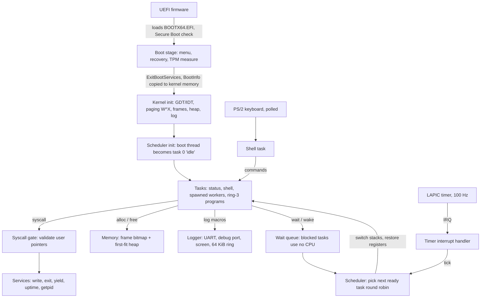

# Aeon: architecture document (CA-6)

Aeon is a small x86_64 operating system written in Rust (`no_std`, no third-party crates). It starts from UEFI, runs preemptive tasks on a 100 Hz timer, gives each ring-3 program a contained window, and has a shell. Source: `G:\Aeon\OS\src` (about 14,500 lines of Rust without the generated font data).

## 1. Layers

| Layer | What it does | Main files |
|---|---|---|
| Boot stage | Takes over from the firmware: menu (Dawn), recovery mode, boot counting, TPM measurement, memory map, leaves the firmware | `main.rs`, `uefi.rs`, `tcg2.rs`, `eventlog.rs`, `bootcount.rs`, `bootopts.rs`, `splash.rs`, `fb.rs` |
| Kernel core | CPU tables, paging, interrupts, timer, scheduler, memory | `arch.rs`, `paging.rs`, `apic.rs`, `sched.rs`, `frames.rs`, `heapalloc.rs`, `mm.rs` |
| Kernel services | Synchronization, logging, system calls, file system, disk | `spin.rs`, `waitq.rs`, `log.rs`, `syscall.rs`, `usercopy.rs`, `ramfs.rs`, `vblk.rs`, `fat.rs` |
| User mode | Ring-3 programs behind the `syscall` gate | `usermode.rs` |
| Shell (Pulse) | The only interactive program: 48 commands, including aliases | `shell.rs`, `cmdhelp.rs`, `lineedit.rs`, `keymap.rs` |
| Pure logic, tested on the PC | Algorithms with no hardware access: allocators, parsers, wait list, file system, scheduler policies, Banker's algorithm | `frames.rs`, `heapalloc.rs`, `waitq.rs`, `ramfs.rs`, `fat.rs`, `schedpolicy.rs`, `banker.rs`, `memmap.rs`, `acpi.rs` |

## 2. Data and control flow

The arrows are real calls or hardware events:

| Flow | Path | What moves |
|---|---|---|
| Boot to kernel | `efi_main` fills `BootInfo` (memory map, framebuffer, ACPI, CPU features, seed) and leaves the firmware | One struct, copied into kernel memory before `ExitBootServices` |
| Preemption | LAPIC timer -> interrupt gate -> `sched::tick` -> switch routine | CPU registers and the FPU/SSE state are saved on the old task's kernel stack and restored from the new one |
| Voluntary switch | `yield_now` raises the yield vector; `sleep_ms` and `WaitQueue::wait` mark the task not ready and yield | Task state field (`Ready`, `Running`, `Blocked`, `Sleeping`) |
| System call | ring 3 `syscall` -> entry stub -> pointer checks in `usercopy` -> handler -> `sysret` | Arguments in registers; user buffers are copied with SMAP lifted for the copy only |
| Memory | `alloc_frames` / `free_frames` (4 KiB frames, bitmap) and `GlobalAlloc` (heap carved from frames) | Physical addresses (identity mapped: physical = virtual) |
| Logging | `info!`, `warn!`, `error!` -> logger (interrupts off) -> UART, QEMU debug console, framebuffer, ring | Formatted text lines with a timestamp from the TSC |

## 3. Task model and states

A task is a fixed slot in an array of 16 (`MAX_TASKS`). Each has a 32 KiB kernel stack with a guard page, a saved stack pointer, a state, a CPU-tick counter and a name.

| State | Meaning | Leaves the state when |
|---|---|---|
| `Ready` | Can run | The scheduler picks it |
| `Running` | On the CPU | Its 10 ms slice ends, or it yields, sleeps or blocks |
| `Sleeping` | Waiting for a tick count | `wake_tick` is reached |
| `Blocked` | Waiting on a wait queue | `wake_all` makes it `Ready` |
| `Dead` | Ended or killed; its stack is freed | The slot becomes `Free` |
| `Free` | Slot unused | `spawn` claims it |

The ready "queue" is the array scanned round robin from the task after the current one. Round robin is therefore fair by construction: every `Ready` task is visited once per cycle.

## 4. Memory map of the design

| Region | Owner | Notes |
|---|---|---|
| Kernel image | Linker | Text read+execute, data read+write, never both (W^X) |
| Frame bitmap | `mm.rs` | One bit per 4 KiB frame, next-fit search |
| Kernel heap | `heapalloc.rs` | Up to 32 MiB carved from free frames, first-fit with coalescing |
| Task stacks | `sched.rs` | 8 frames + 1 guard page each, wiped when freed |
| Ring-3 window | `usermode.rs` | 64 KiB: code page read+execute, rest read+write |
| Page tables | `paging.rs` | Identity map up to 1 TiB, unmapped null page, guard pages |

## 5. Trust and containment (the specialization)

| Mechanism | Where | What it stops |
|---|---|---|
| Secure Boot signature and SBAT | Build and `tools/sign.sh` | Running an unsigned or revoked image |
| Measured boot (TPM PCR 11, 12) with event-log replay | `tcg2.rs`, `eventlog.rs` | Silent change of the boot path or command line |
| NX, W^X, SMEP, SMAP, UMIP | `paging.rs`, `arch.rs` | Executing data, kernel running user code, kernel reading user memory by accident |
| Ring 3 plus syscall pointer checks | `usermode.rs`, `usercopy.rs`, `syscall.rs` | A program touching kernel memory or passing a bad pointer |
| Fault containment | `usermode::user_fault` | A faulting program takes down only itself |
| Boot counting and recovery mode | `bootcount.rs` | A boot that keeps failing: after 3 failures the next boot is a minimal recovery boot |
| Interrupts-off rule, checked in code | `global.rs` (`get_irqs_off`) | Shared kernel state touched while an interrupt could run |

## 6. What is outside the design (limits)

One CPU only; one shared address space (no per-program page tables); one built-in ring-3 program at a time; the RAM file system vanishes on reboot; the disk driver is read-only and virtio-only; no networking. These are listed again, with reasons, in the final report.
