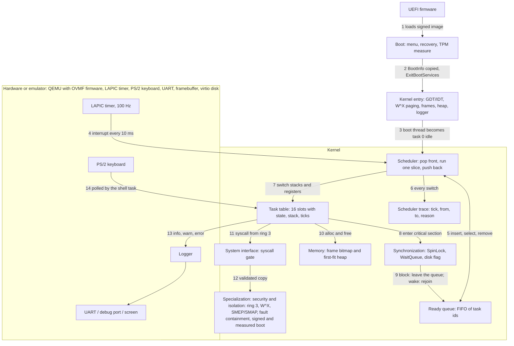

# Aeon: architecture document (CA-6)

Aeon is a small x86_64 operating system written in Rust (`no_std`, no third-party crates). It starts from UEFI, runs preemptive tasks on a 100 Hz timer, gives each ring-3 program a contained window, and has a shell. Source: `S:\Works\Projects\Aeon\OS\src` (about 15,000 lines of Rust without the generated font data).

## 1. The ten layers of the assignment, and where each lives

| Layer | Name | Aeon's implementation | Files |
|---|---|---|---|
| 1 | Boot | UEFI loads the signed image; `efi_main` builds `BootInfo`, leaves the firmware, starts the kernel; a startup banner is printed and the system stays up | `main.rs`, `uefi.rs`, `bootinfo.rs` |
| 2 | Console and diagnostics | Logger with levels (error, warn, info, debug, trace) and structured lines `[seconds] LEVEL target key=value`; four sinks (screen, UART, QEMU debug port, 64 KiB ring) | `log.rs`, `logfmt.rs`, `fb.rs` |
| 3 | Task representation | `Task`: id (slot), state, saved context (stack pointer), stack, tick counter, name; states Free, Ready, Running, Sleeping, Blocked, Dead | `sched.rs` |
| 4 | Ready queue | `ReadyQueue<16>`: FIFO ring of ids with insert, select, remove and ordering; the invariant "queue = tasks in state Ready" is checkable with `queue` | `readyq.rs`, `sched.rs` |
| 5 | Round robin | Pop the front, run one 10 ms slice, put the task at the back; every switch is recorded in the scheduler trace with its reason | `sched.rs`, `schedtrace.rs` |
| 6 | Timer-driven scheduling | LAPIC timer at 100 Hz drives preemption; `spawn coop` shows the cooperative alternative; the trace tells them apart | `apic.rs`, `arch.rs`, `sched.rs` |
| 7 | Synchronization | `SpinLock` (interrupt-safe critical section), `WaitQueue` (blocking), disk busy flag; `race` shows the problem and the fix | `spin.rs`, `waitq.rs`, `sched.rs`, `shell.rs` |
| 8 | Memory management | Frame bitmap allocator plus first-fit free-list heap with coalescing; `mem` and `alloc` give statistics and a refusal path | `frames.rs`, `heapalloc.rs`, `mm.rs` |
| 9 | System interface (optional) | `syscall` gate for ring-3 programs: write, exit, yield, uptime, getpid, with pointer validation | `usermode.rs`, `usercopy.rs`, `syscall.rs` |
| 10 | Integrated micro-OS | All of the above running together under the shell | `shell.rs` |

## 2. Data and control flow

The numbered arrows are real calls or events:

| # | Flow | What moves |
|---|---|---|
| 1, 2 | Boot to kernel | One struct, `BootInfo` (memory map, framebuffer, ACPI pointers, CPU features, seed), copied into kernel memory before the firmware is left |
| 3 | Kernel entry | The boot thread becomes task 0, the idle task; interrupts are then enabled |
| 4 | Timer to scheduler | Interrupt gate calls `aeon_sched_irq` with the interrupted stack pointer; it returns the stack pointer to resume |
| 5 | Scheduler and queue | New and woken tasks are inserted at the back; the scheduler selects the front; a killed task is removed from wherever it is |
| 6 | Trace | Each real switch appends `(tick, from, to, reason)` where reason is timer, yield, block, sleep or exit |
| 7 | Context switch | 512 bytes of FPU/SSE state, 15 general registers and the interrupt frame are saved on the old task's stack and restored from the new one's |
| 8, 9 | Synchronization | A spinlock switches interrupts off for a short critical section. A wait queue takes the caller out of the ready queue until `wake_all` puts it back |
| 10 | Memory | `alloc_frames` / `free_frames` for 4 KiB frames; the heap is carved from frames and serves `Vec` and `String` |
| 11, 12 | System call | ring 3 `syscall` -> entry stub -> pointer checks -> handler -> `sysret`; user buffers are copied with SMAP lifted only for the copy |
| 13 | Logging | Formatted lines with a TSC timestamp to the screen, UART, debug port and ring |
| 14 | Input | The shell task polls the keyboard controller every 10 ms |

## 3. Task states and the ready queue

| State | Meaning | In the ready queue? | Leaves the state when |
|---|---|---|---|
| `Ready` | Can run | **yes** | The scheduler selects it |
| `Running` | On the CPU | no | Its 10 ms slice ends, or it yields, sleeps, blocks or ends |
| `Sleeping` | Waiting for a tick count | no | `wake_tick` is reached: becomes `Ready` and is inserted at the back |
| `Blocked` | Waiting on a wait queue | no | `wake_all` makes it `Ready` and inserts it at the back |
| `Dead` | Ended or killed (the assignment's TERMINATED) | no (removed by `kill`) | Its stack is freed and the slot becomes `Free` |
| `Free` | Slot unused | no | `spawn` claims it |

The idle task (task 0) is never queued: it runs only when the queue is empty. The invariant "the queue holds exactly the tasks in state `Ready`" is checked by `queue` and by the boot tests after every scenario.

## 4. Memory layout of the design

| Region | Owner | Notes |
|---|---|---|
| Kernel image | Linker | Text read+execute, data read+write, never both (W^X) |
| Frame bitmap | `mm.rs` | One bit per 4 KiB frame, next-fit search |
| Kernel heap | `heapalloc.rs` | Up to 32 MiB carved from free frames, first-fit with coalescing |
| Task stacks | `sched.rs` | 8 frames + 1 guard page each, wiped when freed |
| Scheduler trace | `sched.rs` | 1024 events, 16 KiB, in `.bss` (not in the image) |
| Ring-3 window | `usermode.rs` | 64 KiB, allocated on first use, kept and wiped before each program |
| Page tables | `paging.rs` | Identity map up to 1 TiB, unmapped null page, guard pages |

## 5. Specialization: Security and Isolation (Track F), and its trust boundaries

Track F asks teams to identify trust boundaries, controlled kernel interfaces, memory-access boundaries, task isolation and privilege separation.

| Trust boundary | Who is on each side | What enforces it | What crosses it, and how |
|---|---|---|---|
| Firmware / kernel | UEFI firmware (trusted to start us) and the Aeon image | Secure Boot signature, SBAT, TPM measurement of the command line and boot phase | The signed image; one `BootInfo` struct |
| Ring 0 / ring 3 | Kernel and user programs | CPU privilege level, page permissions (user pages never writable and executable), SMEP, SMAP, UMIP | Only the `syscall` instruction, with 5 numbered calls |
| User pointer / kernel memory | A syscall argument and kernel data | `usercopy` range checks (no overflow, inside the user window), SMAP lifted only during the copy | Bytes copied, never a raw pointer dereference |
| Task / task | Two kernel tasks, or a user task and the shell | Separate kernel stacks with guard pages; fault containment kills only the faulting task | Nothing shared except by the kernel's own globals |
| Interrupt context / task context | The timer handler and any task | Interrupts-off rule, checked by `Global::get_irqs_off` | Scheduler state, logger, allocator |
| Boot attempt / next boot | A failing boot and the following one | Boot counter in firmware variables, recovery mode after 3 failures | A counter and a recovery flag |

Privilege separation inside the kernel is not attempted: all kernel code runs at ring 0 with one address space. That is listed as a limit, with per-program address spaces as the planned next step.

## 6. Limits of the design

One CPU only; one shared address space (no per-program page tables); one built-in ring-3 program at a time; the RAM file system vanishes on reboot; the disk driver is read-only and virtio-only; no networking.
