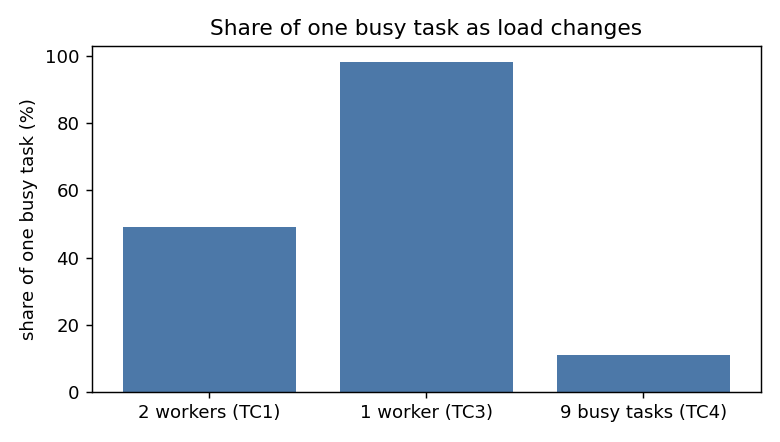
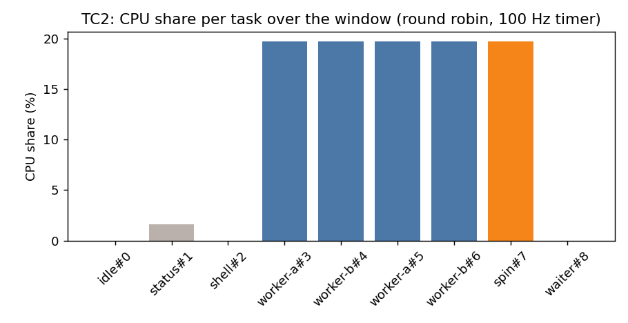
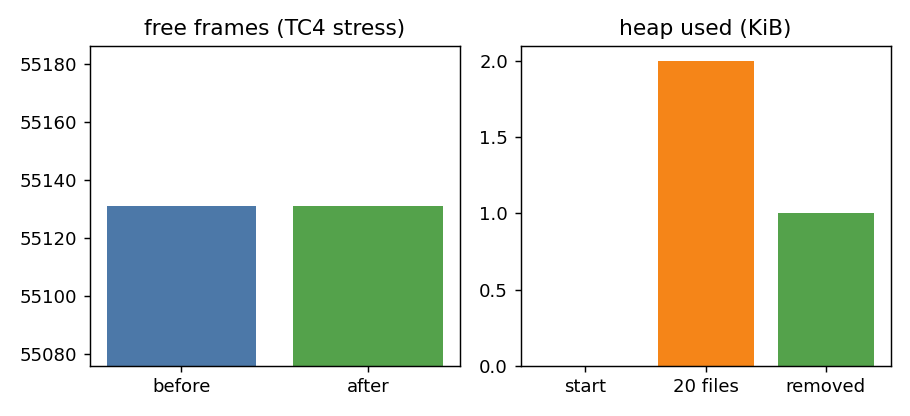
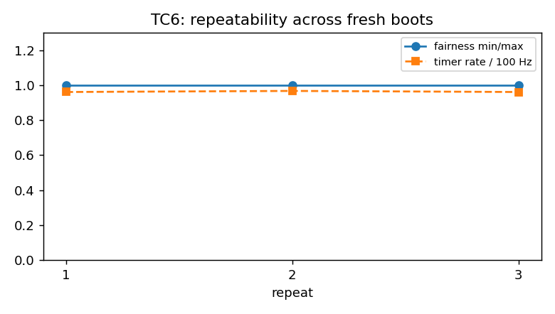

# Aeon: performance data (CA-6)

Source of every number: `evidence/results.csv`, produced by `tests/ca6_evidence.py` on the 0.9.0 build in QEMU with software emulation (so ratios and counts matter, absolute speeds do not).

## 1. Scheduler behaviour

| Configuration | Busy tasks | CPU share of one busy task | Fairness (min/max) |
|---|---|---|---|
| TC3: one worker | 1 | 98.2% | n/a |
| TC1: two workers | 2 | 49.0% each | 1.000 |
| TC2: four workers + one ring-3 task | 5 | 19.7% each | 1.000 |
| TC4: eight workers + one ring-3 task | 9 | 10.9% each | 1.000 |

How to read this: with `n` busy tasks, round robin should give each about `1/n` of the CPU, less what the `status` task takes (1.6% to 1.9%, because it redraws the status bar twice a second). The measured values follow `1/n`: 98.2 (1 task), 49.0 (2), 19.7 (5), 10.9 (9). Equal ticks, not just similar ones: the two workers in TC1 got 304 and 304.

The `idle` task and the `shell` task show 0% because they are not busy: the shell sleeps in 10 ms steps while waiting for a key, and idle only runs when nothing else is ready.

A task blocked on a wait queue used 0 ticks over a 3 s window (M6), so blocking really takes the task out of scheduling.

## 2. Timer

| Measure | Value |
|---|---|
| Nominal tick rate | 100 Hz (10 ms slice) |
| Measured tick rate, three repeats | 96.1, 96.7, 96.1 Hz |
| Spread across repeats | 0.64% |
| Timer source | local APIC, calibrated against the TSC (PIT is the fallback) |

The measurement divides the tick count in a window by the host-clock seconds between two typed `ps` commands, so it includes the delay of typing. The gap from 100 Hz is therefore an upper bound on the true error, and it is stable. A kernel-side comparison of ticks against the TSC would remove the host from the measurement.

## 3. Memory

| Measure | Before | After the stress | Note |
|---|---|---|---|
| Free frames | 55131 | 55131 | Nine busy tasks, ten ring-3 launches, then all stopped: nothing leaked |
| Heap used | 0 KiB | 2 KiB with 20 files, 1 KiB after removing them | 1 KiB residue, see test results finding 3 |
| One-time ring-3 window | 16 frames (64 KiB) | kept and reused | Allocated at the first `run`, wiped before every program |

## 4. Boot and size

| Measure | Value |
|---|---|
| Kernel uptime when the shell starts | 3.25 s (3.214 to 3.261 over three boots, spread 1.46%). About 2 s of this is the boot-menu wait |
| Unsigned image | 248,832 bytes |
| Signed release image | 250,408 bytes (limit 262,144) |
| Source | about 14,500 lines of Rust without the generated font data |

## 5. Repeatability

Three fresh boots gave the same fairness (1.000), tick rates within 0.64% and boot times within 1.46%.

## 6. Comparison with the course's scheduling numbers

`src/schedpolicy.rs` reproduces the course's worked example (four processes, arrivals 0, 1, 2, 3, bursts 8, 4, 9, 5) as a pure simulator:

| Policy | Average waiting | Course notes | Matches |
|---|---|---|---|
| FCFS | 8.75 | 8.75 | yes |
| SJF (non-preemptive) | 7.75 | 7.75 | yes |
| SRTF | 6.50 | 6.5 | yes |
| Round robin, quantum 4 | 11.75 | 11.75 | yes |
| Priority (preemptive) | 7.00 | 7.75 | **no: the notes are wrong**, see the debugging log |

The kernel's own scheduler is round robin, so the live equivalent of the table is the round-robin row: a quantum of 10 ms and equal shares, as measured above.
