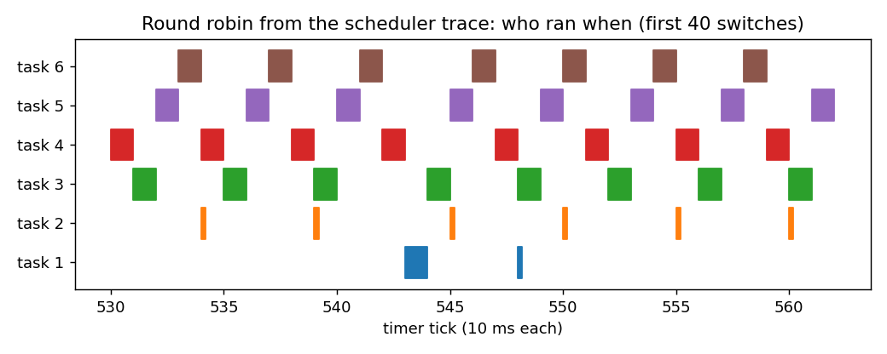
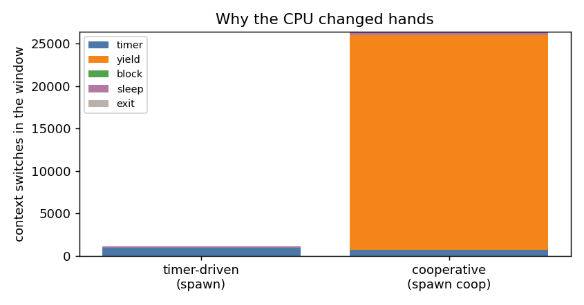
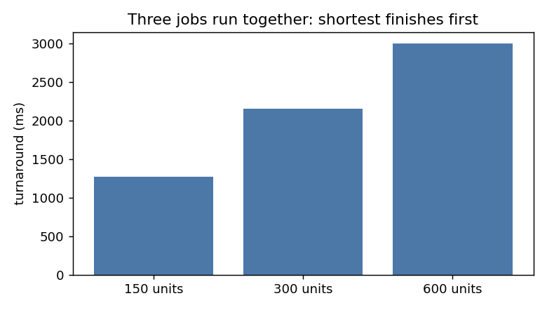
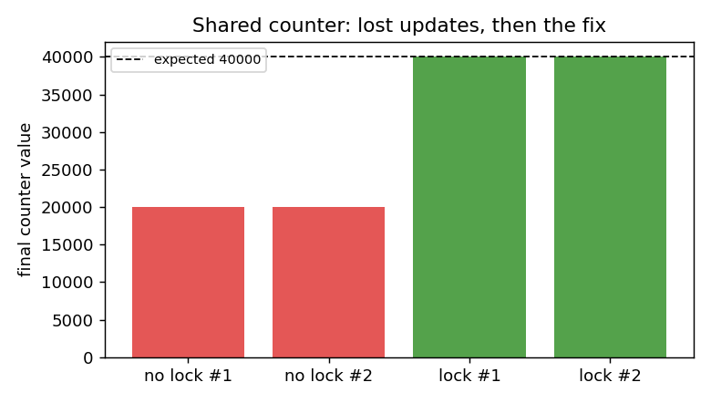
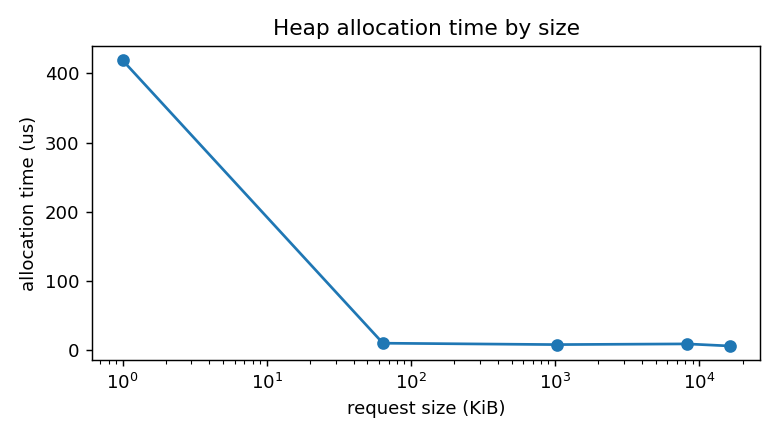

# Aeon: performance data (CA-6)

Source of every number: `evidence/results.csv`, produced by `tests/ca6_evidence.py` on the 0.9.1 build in QEMU with software emulation (so ratios, orders and counts matter; absolute speeds do not).

## 1. Scheduler: the trace

Four busy workers, 6 s, read back from the kernel's own scheduler trace by the Python parser:

| Property | Result | Meaning |
|---|---|---|
| Switches per second | 183 | About 100 timer switches plus the short visits of `shell` and `status` |
| Why a worker left the CPU | 100% timer | Workers never yield, so only the timer can take the CPU |
| Time slice | 100% of worker stretches last exactly 1 tick | The slice is 10 ms |
| Order | 100% of turns match the turn one cycle earlier | Round robin takes turns in a fixed cycle |
| Scheduling latency (mean, max) | 3.07 and 4 ticks | With 4 workers each waits about 3 slices |

## 2. Cooperative against timer-driven (layer 6)

| Workers | Switches per second | Share that were `yield` | Share that were timer |
|---|---|---|---|
| `spawn` (never yield) | 183 | 0% | 82% of all switches (906 of 1099); the other 18% are `shell` and `status` going back to sleep; 100% of the workers' own departures |
| `spawn coop` (yield after a little work) | 4401 | 95.9% (25312 of 26408) | 2.7% (722); sleep 1.4% (374) |

The cooperative workers switch 24 times as often because nothing makes them wait for the 10 ms tick. They are also at the mercy of each other: one that stopped yielding would hold the CPU until the timer took it, which is why a timer is needed at all.

## 3. Share of CPU and fairness

| Configuration | Busy tasks | Share of one busy task | Fairness (smallest over largest) |
|---|---|---|---|
| TC3: one worker | 1 | 98.2% | n/a |
| TC1: two workers | 2 | 49.0% each | 1.000 (306 and 306 ticks); the three TC6 repeats gave 304 and 305, ratio 0.997 |
| TC2: four workers and one ring-3 task | 5 | 19.6% to 19.8% | 0.992 |
| TC4: eight workers and one ring-3 task | 9 | 10.9% | 0.986 |

With `n` equal busy tasks each receives about `1/n` less the 1.6% to 1.9% the `status` task takes (it redraws the bar twice a second). The `idle` and `shell` tasks show 0%: the shell sleeps in 10 ms steps and idle runs only when nothing else is ready.

## 4. Jobs that finish: response time, turnaround, throughput

`job 600 300 150` starts three jobs in the same instant.

| Job (units) | First ran after | Turnaround | Predicted ratio to the shortest | Measured ratio |
|---|---|---|---|---|
| 150 | at most 2 ticks | 127 ticks (1.27 s) | 1.000 | 1.000 |
| 300 | at most 2 ticks | 216 ticks | 1.667 | 1.701 |
| 600 | at most 2 ticks | 300 ticks | 2.333 | 2.362 |

The prediction is the "fluid" model of equal-share round robin: with three jobs the shortest needs 3 x 150 = 450 unit-times, the next 450 + 2 x 150 = 750, the last 750 + 1 x 300 = 1050. The measured ratios are within 2.5% of it (1.701 against 1.667, 2.362 against 2.333). Throughput was 350 units per second; one unit of work (20,000 spins) takes about 2.9 ms in QEMU. Finished jobs leave the task table and the ready queue stays consistent.

## 5. The shared-counter race (layer 7)

| Run | Expected | Got | Lost |
|---|---|---|---|
| no lock, run 1 | 40000 | 20000 | 50% |
| no lock, run 2 | 40000 | 20000 | 50% |
| with spinlock, run 1 | 40000 | 40000 | 0 |
| with spinlock, run 2 | 40000 | 40000 | 0 |

The loss is exactly half because the emulator is deterministic: when a racer is preempted in the middle of its read-modify-write, the other racer's slice of work is overwritten when it resumes. On real hardware the loss would vary from run to run.

## 6. Memory

| Measure | Value |
|---|---|
| Free frames before and after the TC4 stress | 55124 and 55124 |
| Heap used: start, with 20 files, after removing them | 0, 2, 1 KiB |
| One-time ring-3 window | 16 frames (64 KiB), allocated at the first `run`, kept and reused |
| Allocation time for 1, 64, 1024, 8192, 16384 KiB | 419, 10, 8, 9, 6 microseconds |
| Refused request (`alloc 99999999`) | refused; heap used and hole count unchanged |

Allocation time does not grow with size because first-fit takes a free hole without touching the memory. The first call is slower; the cause was not investigated.

## 7. Timer, boot and size

| Measure | Value |
|---|---|
| Nominal tick rate | 100 Hz |
| Measured tick rate, three repeats | 96.2, 96.2, 96.2 Hz (spread 0.0%) |
| Kernel uptime when the shell starts | 3.23, 3.25, 3.26 s (spread 1.08%); about 2 s of it is the boot-menu wait |
| Unsigned image | 259,072 bytes |
| Source | about 15,300 lines of Rust without the generated font data |

The tick rate is measured from outside the VM by typed `ps` commands, so the gap from 100 Hz is an upper bound on the true error. A kernel-side comparison of ticks against the TSC would remove the host from the measurement.

## 8. Comparison with the course's scheduling numbers

`src/schedpolicy.rs` reproduces the course's worked example (arrivals 0, 1, 2, 3, bursts 8, 4, 9, 5):

| Policy | Average waiting | Course notes | Matches |
|---|---|---|---|
| FCFS | 8.75 | 8.75 | yes |
| SJF (non-preemptive) | 7.75 | 7.75 | yes |
| SRTF | 6.50 | 6.5 | yes |
| Round robin, quantum 4 | 11.75 | 11.75 | yes |
| Priority (preemptive) | 7.00 | 7.75 | **no: the notes have an arithmetic error**, see the debugging log |

The kernel's own scheduler is round robin; the live counterpart of this table is section 4: three jobs under equal-share round robin, where the measured turnaround ratios match the prediction.

## 9. Not measured

Synchronization wait time (a spinlock never waits on one CPU), I/O latency (the disk driver is read-only and was not timed), any real-hardware speed.
